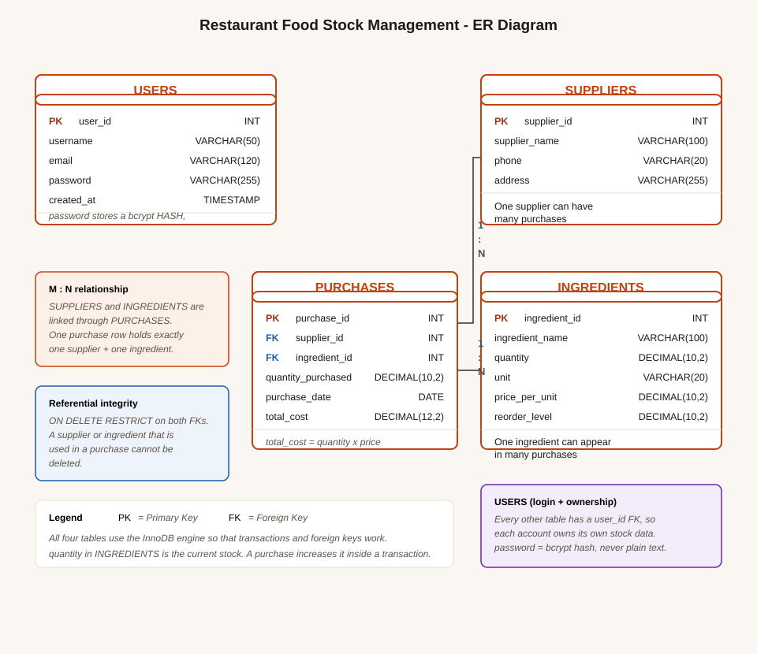

# Restaurant Food Stock Management System

A fully working web application for a college RDBMS mini project. It helps a
restaurant keep track of its food ingredients, its suppliers, what it buys and
how much stock is left — and it warns the kitchen when something needs
re-ordering.

**Stack:** HTML5 + CSS3 + Vanilla JavaScript | PHP 8 | MySQL Server 8.0 | MySQL Workbench | XAMPP (Apache)

---

## Table of contents

1. [What the application does](#1-what-the-application-does)
2. [Project structure](#2-project-structure)
3. [Setting up the database in MySQL Workbench](#3-setting-up-the-database-in-mysql-workbench)
4. [Creating the admin account](#4-creating-the-admin-account)
5. [Connecting the PHP app to MySQL](#5-connecting-the-php-app-to-mysql)
6. [Running the project on localhost](#6-running-the-project-on-localhost)
7. [The database design](#7-the-database-design)
8. [How the security works](#8-how-the-security-works)
9. [Testing the project](#9-testing-the-project)
10. [Viva preparation](#10-viva-preparation)
11. [Troubleshooting](#11-troubleshooting)

---

## 1. What the application does

| Page | What it does |
|------|--------------|
| **Login** | The front page. Username **or** email + password, a show/hide password button, and a clear error message for wrong details. |
| **Dashboard** | Four summary cards (ingredients, suppliers, purchases, low-stock count), the total money spent, the value of the current stock, a bar chart of stock value per ingredient, the low-stock list and the most recent purchases. |
| **Suppliers** | Add, view, search, edit and delete suppliers. A supplier that already has purchases cannot be deleted. |
| **Ingredients** | Add, view, search, edit and delete ingredients. Shows the current stock, a stock-level meter and a **Low stock** badge when the quantity has reached the reorder level. |
| **Purchases** | Record a purchase by choosing a supplier and an ingredient. The total cost is worked out automatically (quantity × price per unit) and the ingredient's stock is updated **immediately** using a database transaction. Shows the full purchase history with search. |
| **Low Stock Alerts** | Every ingredient at or below its reorder level, how much is short, and what it will cost to re-order it. |
| **Logout** | Ends the session and returns to the login page. The link is in the sidebar, under the name of the logged-in user. |

### The address in the browser

```
http://localhost/restaurant-stock-management/
```

You land on the **login page** first. After logging in you get the dashboard.

---

## 2. Project structure

```
restaurant-stock-management/
│
├── index.php                 Entry point - sends you to the login page or the dashboard
├── dashboard.php             The dashboard (summary cards, chart, recent purchases)
├── suppliers.php             Supplier management
├── ingredients.php           Ingredient management
├── purchases.php             Purchase management (records a purchase + updates the stock)
├── low_stock.php             Low stock alerts
├── START_HERE.bat            Double-click this to start MySQL + Apache and open the app
│
├── auth/
│   ├── login.php             The login page
│   └── logout.php            Ends the session
│
├── config/
│   └── db.php                *** THE ONLY FILE YOU NORMALLY EDIT ***
│                            MySQL host, port, database name, username, password
│
├── includes/
│   ├── auth.php              Login, logout, session handling, require_login()
│   ├── header.php            Opens the page, draws the sidebar, **calls require_login()**
│   ├── footer.php            Closes the page
│   ├── functions.php         Helper functions (escaping, messages, formatting, validation)
│   └── actions.php           All the INSERT / UPDATE / DELETE logic, including the transaction
│
├── setup/
│   └── create_admin.php      Creates the admin account with a hashed password
│
├── assets/
│   ├── css/
│   │   ├── style.css         The dashboard design system (light + dark, responsive)
│   │   └── login.css         The login page design
│   ├── js/
│   │   ├── app.js            Sidebar toggle, search filter, modals, live total cost
│   │   └── login.js          Show/hide password, login form validation
│   └── er-diagram.svg        The ER diagram
│
├── sql/
│   ├── schema.sql            *** RUN THIS FIRST *** - creates the database and the 4 tables
│   └── sample_data.sql       Optional - loads example records so the dashboard has data
│
├── test_auth.php             Tests the login and the password security
├── test_rollback.php         Tests the transaction / rollback
├── test_edge_cases.php       Tests the validation rules
├── test_e2e.sh               End-to-end test over HTTP
└── README.md                 This file
```

---

## 3. Setting up the database in MySQL Workbench

> **A quick note on Workbench vs MySQL Server.**
> **MySQL Server** is the program that actually stores your data and answers
> queries. **MySQL Workbench** is only the *graphical tool* you use to talk to
> that server. Workbench is not a database — it is a remote control for one.
> PHP connects to the **MySQL Server**, and this project makes both of them
> point at the same server so you can see the same data in both.

### 3.1 Which server this project uses

| | Port | Used by |
|---|---|---|
| **MySQL Server 8.0** | **3307** | **MySQL Workbench + this PHP project** ✅ |
| XAMPP's MariaDB 10.4 | 3306 | phpMyAdmin and the other XAMPP tools |

Port 3306 was already taken by XAMPP, so MySQL Server 8.0 was set up on
**3307**. Workbench and PHP both use 3307, so they always see the same data.

The server lives in:

```
C:\mysql-server-8.0\PFiles64\MySQL\MySQL Server 8.0\
```

and it is configured by:

```
C:\mysql-server-8.0\my.ini
```

### 3.2 Starting the server

Double-click **`START_HERE.bat`** in the project folder. It starts MySQL
Server 8.0, checks Apache, and opens the app in your browser.

You can also start it by hand:

```
C:\mysql-server-8.0\PFiles64\MySQL\MySQL Server 8.0\bin\mysqld.exe --defaults-file=C:\mysql-server-8.0\my.ini
```

It also starts automatically when you log in to Windows (a small script sits
in the Startup folder).

### 3.3 Running the schema in Workbench

1. Open **MySQL Workbench**.
2. On the home screen click the connection **"Local instance MySQL80"**.
   - If you do not see it, click **"New Connection"** and fill in:
     - Connection Name: `Local instance MySQL80`
     - Host: `127.0.0.1`
     - Port: `3307`
     - Username: `root`
     - Password: `YOUR_MYSQL_PASSWORD`
3. Click **File → New Query Tab** (or press `Ctrl+T`).
4. Click **Open**, choose `sql/schema.sql`, and press the **lightning bolt
   (Execute)** button.
5. The output should say `Database created successfully` and list the tables:

```
Tables_in_restaurant_stock_management
ingredients
purchases
suppliers
users
```

6. **Optional but recommended:** do the same with `sql/sample_data.sql` to fill
   the tables with example suppliers, ingredients and purchases, so the
   dashboard has something to show.

> `schema.sql` starts with `DROP TABLE IF EXISTS`, so you can re-run it safely.
> It **deletes the data** in those tables, so back up anything you have entered.

---

## 4. Creating the admin account

The account is **not** created by the SQL file, because the password has to be
stored as a bcrypt hash, and the only correct way to make that hash is PHP's
`password_hash()` function.

Open a command prompt and run:

```bat
cd C:\xampp\htdocs\restaurant-stock-management
C:\xampp\php\php.exe setup\create_admin.php
```

It prints something like:

```
==============================================
 YOUR LOGIN DETAILS
==============================================
  URL      : http://localhost/restaurant-stock-management/
  Username : admin
  Email    : admin@restaurant.local
  Password : YOUR_ADMIN_PASSWORD
==============================================
```

To change the username, email or password, edit the **SETTINGS** block at the
top of `setup/create_admin.php` and run it again. If the account already
exists, the script **updates** it instead of failing — so the same command
also works as a password reset.

### Each user has their own data

This is important: the `users` table does not only control *who* can log in.
The other three tables each have a `user_id` column:

```
users ──1:N──> suppliers      (user_id)
users ──1:N──> ingredients    (user_id)
users ──1:N──> purchases      (user_id)
```

So when Shriya logs in she sees only the suppliers, ingredients, purchases
and dashboard numbers she entered. A different account starts with a
completely empty dashboard. Nothing is shared between accounts.

How this is enforced:

- `current_user_id()` in `includes/auth.php` reads the logged-in id from the session.
- Every `SELECT` in the pages includes `WHERE user_id = ?`.
- Every `INSERT` in `includes/actions.php` stores `user_id` with the new row.
- Every `UPDATE` / `DELETE` includes `AND user_id = ?`, so guessing another
  row's id does not let one user change somebody else's data.
- `ingredient_name` is `UNIQUE(user_id, ingredient_name)`, so two users may
  both track "Rice" without clashing.

**Upgrading an older database:** run `sql/migrate_user_data.sql` once in
MySQL Workbench. It adds the columns and gives all existing rows to `admin`,
so nothing already entered is lost.

### Signing up from the website

You do **not** have to use the setup script to get an account. The login page
has a **"Sign up"** link that opens `auth/signup.php`. A visitor enters a
username, email and password (twice), and the app:

1. checks the values again on the server,
2. hashes the password with `password_hash()`,
3. inserts a new row into the `users` table with a prepared statement,
4. signs the new user in straight away.

The password is always stored as a 60-character bcrypt hash — never as plain
text. Try it in MySQL Workbench after signing up:

```sql
USE restaurant_stock_management;
SELECT user_id, username, email, password, created_at FROM users;
```

The `password` column will start with `$2y$`, which is how you recognise a
bcrypt hash.

You can check the admin account in Workbench:

```sql
USE restaurant_stock_management;
SELECT user_id, username, email, created_at FROM users;
```

The `password` column will show a hash like
`$2y$10$OX4wPbBta.Gv3.diHQqjNOvtp4LMWdiLElBM0x9TtoisVg3NIJ.sS` — **not** the
password itself.

---

## 5. Connecting the PHP app to MySQL

Open `config/db.php`. This is the only file you normally need to edit.

```php
$db_host = '127.0.0.1';
$db_name = 'restaurant_stock_management';
$db_user = 'root';
$db_pass = 'YOUR_MYSQL_PASSWORD';
$db_port = '3307';
```

| Situation | What to enter |
|-----------|---------------|
| **This project (MySQL Server 8.0)** | host `127.0.0.1`, port `3307`, user `root`, password `YOUR_MYSQL_PASSWORD` |
| XAMPP's own MariaDB (phpMyAdmin) | host `127.0.0.1`, port `3306`, user `root`, password empty |
| A MySQL Server on another machine | host = that machine's IP, e.g. `192.168.1.5` |

### Why `127.0.0.1` and not `localhost`?

This is a real detail worth explaining in the viva.

On Windows, when the host is written as `localhost`, PDO connects to MySQL over
a **named pipe** instead of over TCP. A named pipe always belongs to **one**
MySQL instance — the one XAMPP installs — so writing `localhost` can silently
connect you to XAMPP's MariaDB even when you meant the MySQL Server on 3307.

Writing the IP address `127.0.0.1` forces a plain TCP connection to the port
number written next to it. That is why this project uses `127.0.0.1`.

The app uses **PDO with prepared statements** everywhere, so it is safe from
SQL injection.

---

## 6. Running the project on localhost

### The short version

1. Copy the whole `restaurant-stock-management` folder into `C:\xampp\htdocs\`.
2. Open the **XAMPP Control Panel** and start **Apache**.
3. Double-click **`START_HERE.bat`** (this starts MySQL Server 8.0 and opens
   the app).
4. Visit **http://localhost/restaurant-stock-management/**
5. Log in with **`admin`** / **`YOUR_ADMIN_PASSWORD`**.

### If the database has not been set up yet

Run `sql/schema.sql` in Workbench (section 3.3) and then
`setup/create_admin.php` (section 4) first.

### Option B — PHP's built-in server

If you already have MySQL running, you can skip Apache:

```bat
cd C:\xampp\htdocs\restaurant-stock-management
C:\xampp\php\php.exe -S localhost:8000
```

Then visit **http://localhost:8000**

> The built-in server is single-threaded, so pages load one at a time. That is
> fine for a demo, but Apache feels smoother.

---

## 7. The database design

Four tables, exactly as required.

### USERS
| Column | Type | Notes |
|--------|------|-------|
| user_id | INT AUTO_INCREMENT | **Primary key** |
| username | VARCHAR(50) | UNIQUE - the login name |
| email | VARCHAR(120) | UNIQUE - can also be used to log in |
| password | VARCHAR(255) | The **bcrypt hash**, never the plain password |
| created_at | TIMESTAMP | Set automatically |

### SUPPLIERS
| Column | Type | Notes |
|--------|------|-------|
| supplier_id | INT AUTO_INCREMENT | **Primary key** |
| supplier_name | VARCHAR(100) | |
| phone | VARCHAR(20) | |
| address | VARCHAR(255) | |

### INGREDIENTS
| Column | Type | Notes |
|--------|------|-------|
| ingredient_id | INT AUTO_INCREMENT | **Primary key** |
| ingredient_name | VARCHAR(100) | UNIQUE - stops the same ingredient being added twice |
| quantity | DECIMAL(10,2) | **The current available stock** |
| unit | VARCHAR(20) | kg, litres, pieces, packs... |
| price_per_unit | DECIMAL(10,2) | Used to calculate the cost of a purchase |
| reorder_level | DECIMAL(10,2) | The minimum stock - drives the low-stock alert |

### PURCHASES
| Column | Type | Notes |
|--------|------|-------|
| purchase_id | INT AUTO_INCREMENT | **Primary key** - generated automatically |
| supplier_id | INT | **Foreign key** → suppliers.supplier_id |
| ingredient_id | INT | **Foreign key** → ingredients.ingredient_id |
| quantity_purchased | DECIMAL(10,2) | |
| purchase_date | DATE | |
| total_cost | DECIMAL(12,2) | quantity_purchased × price_per_unit |



### The relationships

1. **Suppliers → Purchases** : **one-to-many**. One supplier can have many
   purchases.
2. **Ingredients → Purchases** : **one-to-many**. One ingredient can appear in
   many purchases.
3. **Suppliers ↔ Ingredients** : **many-to-many**, *through* the purchases
   table. The same ingredient can be bought from several suppliers, and the
   same supplier can supply several ingredients.

Because `ingredients.ingredient_name` is UNIQUE, buying the same ingredient
again **never creates a second ingredient row** — it creates a new row in
`purchases` and adds to the existing `quantity`. That is how the stock stays
correct.

### The low stock rule

An ingredient is **low stock** when:

```
quantity <= reorder_level
```

(less than **or equal to**). If the reorder level is 10 kg and exactly 10 kg
are left, the kitchen is warned.

---

## 8. How the security works

### Passwords

| Step | Code | Why |
|------|------|-----|
| Create the account | `password_hash($password, PASSWORD_DEFAULT)` | Produces a bcrypt hash with a random salt. Two identical passwords never produce the same hash. |
| Store it | `INSERT INTO users (..., password) VALUES (?, $hash)` | Only the hash is ever written to the database. |
| Check it | `password_verify($typedPassword, $storedHash)` | Compares the typed password with the hash. |
| Keep it fresh | `password_needs_rehash()` | Re-hashes with the newest settings if the algorithm has moved on. |

The plain password is **never** stored and **never** written to a log.

### Sessions

`includes/header.php` calls `require_login()` before anything else happens. If
there is no valid session, the visitor is redirected to the login page and
**no database data is read at all**. Every protected page gets this for free
just by including the header.

`session_regenerate_id(true)` is called on login, which prevents *session
fixation* (an attacker setting the session id in your browser beforehand).

### Prepared statements

Every query that touches user input uses a prepared statement:

```php
$statement = $pdo->prepare('SELECT * FROM suppliers WHERE supplier_name = ?');
$statement->execute([$search]);
```

The `?` is a placeholder. The value is sent to MySQL **separately** from the
query, so a value like `'; DROP TABLE suppliers; --` is treated as plain text
and never as SQL. This is what protects against **SQL injection**.

### CSRF tokens

Every form has a hidden random token:

```php
<input type="hidden" name="csrf_token" value="...">
```

The server checks it with `hash_equals()` before doing anything. If another
website tries to submit one of your forms, the token will not match and the
request is rejected. This stops **cross-site request forgery**.

### XSS protection

Every value printed into the page goes through `e()`, which is
`htmlspecialchars()`. A supplier called `<script>alert(1)</script>` is shown
as text, not run as JavaScript.

### Foreign keys

`ON DELETE RESTRICT` on both foreign keys means the **database itself**
refuses to delete a supplier or an ingredient that is used in a purchase. You
cannot get a purchase pointing at something that no longer exists.

### Transactions

Recording a purchase touches **two** tables, so it is wrapped in a
transaction:

```php
$pdo->beginTransaction();
    // 1. INSERT the purchase row
    // 2. UPDATE the ingredient's stock
$pdo->commit();      // both worked -> save
// or
$pdo->rollBack();    // something failed -> undo both
```

If the purchase row cannot be saved, the stock is **not** changed either. This
is proved by `test_rollback.php`.

---

## 9. Testing the project

Four test scripts are included.

### The PHP tests

Run them from the project folder:

```bat
cd C:\xampp\htdocs\restaurant-stock-management

C:\xampp\php\php.exe test_auth.php          REM login + password security
C:\xampp\php\php.exe test_rollback.php      REM transactions / rollback
C:\xampp\php\php.exe test_edge_cases.php    REM validation rules
```

They print a line for every check and finish with a summary:

```
==============================================
 RESULT:  29 passed, 0 failed
==============================================
```

### The full end-to-end test

`test_e2e.sh` drives the **real application over HTTP** with `curl`, exactly
like a browser: it logs in, adds data, records a purchase, checks the stock,
tries to delete a supplier that is in use, attempts an SQL injection, and logs
out again.

It needs **Git Bash** (ships with Git for Windows):

```bash
cd /c/xampp/htdocs/restaurant-stock-management
./test_e2e.sh
```

```
==============================================
 RESULT:  24 passed, 0 failed
==============================================
```

> **Note:** `test_rollback.php`, `test_edge_cases.php` and `test_e2e.sh` all
> **clear the three data tables** while they run. Afterwards, reload
> `sql/sample_data.sql` in Workbench to put the example data back.

### The manual test list

| # | Do this | You should see |
|---|---------|----------------|
| 1 | Open `http://localhost/restaurant-stock-management/` | The **login page** |
| 2 | Open `http://localhost/restaurant-stock-management/dashboard.php` without logging in | You are bounced back to the login page |
| 3 | Log in with a wrong password | *"Incorrect username or password."* and you stay on the login page |
| 4 | Log in with `admin` / `YOUR_ADMIN_PASSWORD` | The **dashboard** with the four summary cards |
| 5 | Click the eye icon next to the password | The password becomes visible and hidden again |
| 6 | Add a supplier | It appears in the list with 0 purchases |
| 7 | Try to delete that supplier | It is deleted (it has no purchases) |
| 8 | Try to delete *"Green Valley Farms"* | It is **refused** — it has purchases |
| 9 | Add an ingredient | It appears with its stock and a stock-level meter |
| 10 | Add the same ingredient again | *"An ingredient called ... already exists."* |
| 11 | Record a purchase | A success message, the total cost is right, and the stock goes **up** |
| 12 | Open Low Stock | The ingredients at or below their reorder level are listed |
| 13 | Search for something | The table filters as you type |
| 14 | Click Logout | You are back at the login page and the dashboard is locked again |

---

## 10. Viva preparation

### The one-sentence summary

> "This is a web application for a restaurant to manage its ingredients,
> suppliers, purchases and stock. It is built with PHP and MySQL, it runs
> locally on XAMPP, it connects to a MySQL Server 8.0 through MySQL Workbench,
> and it uses sessions with hashed passwords so that only a logged-in user can
> see the data."

### Questions you should be able to answer

**About the database**
- What is a primary key? A foreign key? What is `AUTO_INCREMENT`?
- What does `ON DELETE RESTRICT` do, and why did you use it?
- What is the difference between `COUNT()`, `SUM()`, `AVG()`, `MIN()` and `MAX()`?
- What is a `LEFT JOIN`, and when do you use it instead of an `INNER JOIN`?
- What does `GROUP BY` do?
- What is the difference between a one-to-many and a many-to-many relationship?
- Why is `ingredient_name` UNIQUE?
- What is an index, and why do you put one on the columns you search by?

**About PHP**
- What is PDO? What is a prepared statement? How does it prevent SQL injection?
- What does `password_hash()` do? Why not store the plain password?
- What is `password_verify()`? What is a salt?
- What is a session? What does `session_start()` do?
- What is a transaction? What is `beginTransaction()`, `commit()` and `rollBack()`?
- What is the difference between `require_once` and `include`?
- What does `htmlspecialchars()` protect against?
- What is the Post/Redirect/Get pattern, and why is it used?

**About the project**
- Walk me through what happens when a user logs in.
- Walk me through what happens when a purchase is recorded.
- Why does the low-stock check use `<=` and not `<`?
- How does the app stop a supplier being deleted while it has purchases?
- Why does the project use `127.0.0.1` instead of `localhost`?

### The three flows to be able to explain

**1. Logging in** (`auth/login.php` → `includes/auth.php`)
The form posts to itself. The server checks the CSRF token, validates that
the fields are not empty, then calls `attempt_login()`. That function looks
the user up with a prepared statement (matching either the username or the
email), and checks the typed password with `password_verify()`. If it matches,
the user id is stored in the session and the visitor is sent to the dashboard.
If it does not match, the same *"Incorrect username or password"* message is
shown — the same message for an unknown user as for a wrong password, so
nobody can find out which usernames exist.

**2. Recording a purchase** (`includes/actions.php`)
The form posts the supplier id, the ingredient id, the quantity and the date.
The server validates all four, then opens a transaction. Inside it, it reads
the price from the `ingredients` table, calculates the total cost, inserts
the purchase row and adds the quantity to the ingredient's stock. If any step
fails, the transaction is rolled back and the stock is left untouched.

**3. The low-stock alert** (`includes/functions.php`)
`is_low_stock()` compares `quantity` with `reorder_level`. The same rule is
used in the SQL (`WHERE quantity <= reorder_level`) so the list on the page and
the number on the dashboard always agree.

---

## 11. Troubleshooting

| Problem | Fix |
|---------|-----|
| *"Database connection failed"* | Check `config/db.php` — the port must be `3307` and the password `YOUR_MYSQL_PASSWORD`. |
| *"Access denied for user 'root'"* | The password is wrong, or the host is `localhost` (which would reach XAMPP's MariaDB on 3306). Use `127.0.0.1`. |
| *"Unknown database 'restaurant_stock_management'"* | You skipped step 3 — run `sql/schema.sql` in Workbench. |
| *"Table 'users' doesn't exist"* | The schema was not run, or it was run against a different server. Check you are on `Local instance MySQL80` (port 3307). |
| *"The correct password does not work"* | The admin account was never created. Run `setup/create_admin.php`. |
| Port 3307 is not listening | Start MySQL Server 8.0 — double-click `START_HERE.bat`. |
| Page loads but the CSS is missing | The folder is not inside `htdocs`. Check the URL has no extra folder level. |
| *"Call to undefined function"* | `includes/header.php` was not included at the top of the page. |
| The login page shows PHP warnings | Make sure `session_start()` runs before anything is printed — `includes/header.php` does this for you. |

---

*Built for a college RDBMS mini project. PHP 8.2 · MySQL Server 8.0.45 · Apache (XAMPP).*
