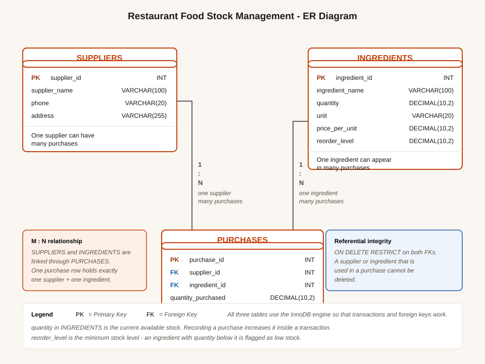

# Restaurant Food Stock Management System

A simple, fully functional web application for a college RDBMS mini project. It helps a
restaurant keep track of its food ingredients, suppliers, purchases and the stock that is
currently available.

**Stack:** HTML + CSS + JavaScript &nbsp;|&nbsp; PHP 8 &nbsp;|&nbsp; MySQL Server &nbsp;|&nbsp; MySQL Workbench

---

## 1. What the application does

| Page | What it does |
|------|--------------|
| **Dashboard** | Shows the total number of ingredients, suppliers and purchases, the total money spent, the value of the current stock, a bar chart of stock value per ingredient, the low-stock list and the most recent purchases. |
| **Suppliers** | Add, view, search, edit and delete suppliers. A supplier that already has purchases cannot be deleted. |
| **Ingredients** | Add, view, search, edit and delete ingredients. Shows the current stock, a stock-level meter and a **Low stock** badge when the quantity drops below the reorder level. |
| **Purchases** | Record a purchase by choosing a supplier and an ingredient. The total cost is calculated automatically (quantity × price per unit) and the ingredient's stock is updated immediately. Shows the full purchase history. |
| **Low Stock Alerts** | Lists every ingredient below its reorder level, how much is short, and what it will cost to re-order it. |

---

## 2. Project structure

```
restaurant-stock-management/
│
├── index.php              Dashboard (summary cards, chart, recent purchases)
├── suppliers.php          Supplier management
├── ingredients.php        Ingredient management
├── purchases.php          Purchase management (records a purchase + updates stock)
├── low_stock.php          Low stock alerts
│
├── config/
│   └── db.php             *** ONLY file you normally need to edit ***
│                           MySQL host, database name, username and password
│
├── includes/
│   ├── header.php         Opens the page and draws the sidebar
│   ├── footer.php         Closes the page
│   ├── functions.php      Helper functions (escaping, messages, formatting, validation)
│   └── actions.php        All INSERT / UPDATE / DELETE logic, including the transaction
│
├── assets/
│   ├── css/style.css      The whole design system (light + dark mode, responsive)
│   ├── js/app.js          Sidebar toggle, search filter, modals, live total cost
│   └── er-diagram.svg     The ER diagram
│
├── sql/
│   ├── schema.sql         *** Run this first *** - creates the database and the 3 tables
│   └── sample_data.sql    Optional - loads example records to fill the dashboard
│
├── test_e2e.sh            End-to-end test that drives the real forms over HTTP
├── test_rollback.php      Test that proves the transaction / rollback works
├── test_edge_cases.php    Test for the validation rules (dates, numbers, FKs)
└── README.md              This file
```

---

## 3. Setting up the database (MySQL Workbench)

1. Open **MySQL Workbench** and connect to your MySQL Server.
2. Click **File → New Query Tab**.
3. Open `sql/schema.sql` (or paste its contents into the query tab).
4. Click the **lightning bolt** (Execute) button.

You should see `Database created successfully` and the three tables:

```
Tables_in_restaurant_stock_management
ingredients
purchases
suppliers
```

**Optional:** run `sql/sample_data.sql` the same way to fill the database with example
suppliers, ingredients and purchases so the dashboard looks full.

> `schema.sql` starts with `DROP TABLE IF EXISTS` so you can re-run it safely. It **deletes
> existing data** in those three tables, so back up anything you have already entered.

---

## 4. Connecting the PHP app to MySQL

Open `config/db.php` and set the four values to match your own MySQL Server:

```php
$db_host = 'localhost';
$db_name = 'restaurant_stock_management';
$db_user = 'root';
$db_pass = '';              // XAMPP default: leave empty
```

| Situation | What to enter |
|-----------|---------------|
| XAMPP / WAMP / Laragon (default install) | host `localhost`, user `root`, password empty |
| MySQL Workbench with a password you set | host `localhost`, user `root`, password your password |
| MySQL on another machine | host = that machine's IP address, e.g. `192.168.1.5` |

The app uses **PDO with prepared statements** everywhere, so it is safe from SQL injection.

---

## 5. Running the project locally

### Option A — XAMPP (easiest)

1. Copy the whole `restaurant-stock-management` folder into
   `C:\xampp\htdocs\` (or `/Applications/XAMPP/htdocs/` on Mac, `/opt/lampp/htdocs/` on Linux).
2. Open the **XAMPP Control Panel** and start **Apache** and **MySQL**.
3. Create the database by running `sql/schema.sql` in MySQL Workbench.
4. Visit: **http://localhost/restaurant-stock-management/**

### Option B — PHP's built-in server

If you already have MySQL running, you can skip Apache:

```bash
cd restaurant-stock-management
php -S localhost:8000
```

Then visit **http://localhost:8000**

> The built-in server is single-threaded, so the pages load one at a time. That is fine for
> a college demo, but Apache (Option A) feels smoother.

### Troubleshooting

| Problem | Fix |
|---------|-----|
| "Database connection failed" | Check `config/db.php` - the password is the usual cause. |
| "Access denied for user 'root'" | The MySQL password is wrong, or your MySQL root user uses a different auth plugin. Set the correct password in `config/db.php`. |
| "Unknown database 'restaurant_stock_management'" | You skipped step 3 - run `sql/schema.sql`. |
| Page loads but CSS is missing | The folder is not inside `htdocs`. Check the URL has no extra folder level. |
| "Call to undefined function" | `includes/header.php` was not included at the top of the page. |

---

## 6. The database design

Three tables, exactly as required.

### SUPPLIERS
| Column | Type | Notes |
|--------|------|-------|
| supplier_id | INT AUTO_INCREMENT | **Primary key** |
| supplier_name | VARCHAR(100) | |
| phone | VARCHAR(20) | |
| address | VARCHAR(255) | |

### INGREDIENTS
| Column | Type | Notes |
|--------|------|-------|
| ingredient_id | INT AUTO_INCREMENT | **Primary key** |
| ingredient_name | VARCHAR(100) | UNIQUE - stops duplicate ingredients |
| quantity | DECIMAL(10,2) | **The current available stock** |
| unit | VARCHAR(20) | kg, litres, pieces, packs... |
| price_per_unit | DECIMAL(10,2) | Used to calculate the purchase cost |
| reorder_level | DECIMAL(10,2) | Minimum stock - drives the low-stock alert |

### PURCHASES
| Column | Type | Notes |
|--------|------|-------|
| purchase_id | INT AUTO_INCREMENT | **Primary key** |
| supplier_id | INT | **Foreign key** → suppliers.supplier_id |
| ingredient_id | INT | **Foreign key** → ingredients.ingredient_id |
| quantity_purchased | DECIMAL(10,2) | |
| purchase_date | DATE | |
| total_cost | DECIMAL(12,2) | quantity_purchased × price_per_unit |



### Relationships

1. **Suppliers → Purchases** : one-to-many. One supplier can have many purchases.
2. **Ingredients → Purchases** : one-to-many. One ingredient can appear in many purchases.
3. **Suppliers ↔ Ingredients** : many-to-many, resolved *through* the Purchases table.

There is **one row per ingredient**. Buying more of an ingredient does not create a second
ingredient row - it adds a purchase row and increases `ingredients.quantity`.

---

## 7. The RDBMS features this project demonstrates

| Requirement | Where it is |
|-------------|-------------|
| Primary keys | All three tables, `AUTO_INCREMENT` |
| Foreign keys | `purchases.supplier_id` and `purchases.ingredient_id` |
| One-to-many relationships | The two joins above |
| INSERT | `includes/actions.php` - add supplier, add ingredient, add purchase |
| UPDATE | Edit supplier, edit ingredient, and `quantity = quantity + ?` for the stock |
| DELETE | Delete supplier, delete ingredient, delete purchase |
| SELECT | Every page reads its data from the database |
| JOIN queries | Purchase history joins all three tables; the supplier and ingredient lists use `LEFT JOIN` with `COUNT()` |
| Aggregate functions | `COUNT()` for the dashboard cards and the purchase counts, `SUM()` for the total spend and the stock value |
| WHERE clause | Every search box, the low-stock filter, the "does this supplier have purchases?" check |
| ORDER BY | Alphabetical supplier/ingredient lists, newest purchases first |
| Referential integrity | `ON DELETE RESTRICT` - the database itself refuses to orphan a purchase |
| Transactions | Recording a purchase uses `BEGIN` / `COMMIT` / `ROLLBACK` |
| Prepared statements | Every single query uses PDO prepared statements with bound parameters |

### The transaction

Recording a purchase changes **two** tables, so both changes must succeed together:

```php
$pdo->beginTransaction();                              // 1. start

$insertPurchase->execute([...]);                      // 2. insert into purchases
$updateStock->execute([$quantity, $ingredientId]);     // 3. add to the stock

$pdo->commit();                                       // 4. save both
// ...or, if anything failed:
$pdo->rollBack();                                     // 5. undo both
```

If the purchase row cannot be saved, the stock is **not** changed either. This is what stops
the two tables from getting out of sync.

---

## 8. Testing

Three test scripts are included.

### Transaction test (PHP)

```bash
php test_rollback.php
```

Proves that a failed purchase changes nothing, that a good purchase updates both tables,
and that deleting a purchase gives the stock back.

### Validation test (PHP)

```bash
php test_edge_cases.php
```

Checks the validation rules - invalid dates, negative numbers, the foreign key stopping an
orphaned purchase, a duplicate ingredient name being rejected, and a purchase being blocked
from deletion when there is not enough stock left to remove.

### End-to-end test (bash + curl)

```bash
bash test_e2e.sh
```

Drives the real forms over HTTP - it reads the CSRF token out of each page and posts the
forms exactly like a browser would. It checks that:

- a supplier and an ingredient can be added
- a duplicate ingredient name is rejected
- **recording a purchase increases the stock by exactly the quantity bought**
- the total cost is stored as quantity × price per unit
- low-stock alerts appear when the stock drops below the reorder level
- a supplier with purchases cannot be deleted
- a SQL injection attempt has no effect
- a request without a valid CSRF token is rejected

---

## 9. Security notes

- **Prepared statements** on every query → no SQL injection.
- **Output escaping** (`e()` in `functions.php`) → no cross-site scripting.
- **CSRF tokens** on every form → another website cannot submit your forms.
- **Server-side validation** on every form → the browser's checks are a convenience, not the guarantee.
- **Foreign keys with `ON DELETE RESTRICT`** → the database protects itself.

---

## 10. Notes for the viva

Points you can talk about with confidence:

1. **Why one row per ingredient?** Because `quantity` *is* the stock level. A purchase adds a
   row to `purchases` and increases `ingredients.quantity` - it never creates a duplicate
   ingredient.
2. **Why a transaction?** The purchase insert and the stock update must both happen. Without
   a transaction, a crash between them would leave the stock wrong.
3. **How is the cost calculated?** The server reads `price_per_unit` from the ingredients
   table and multiplies it by the quantity. The browser also shows a live preview, but the
   number that gets saved is always worked out by the server.
4. **How is referential integrity enforced?** Twice - the application checks before deleting,
   and the database has `ON DELETE RESTRICT` as a safety net.
5. **Why prepared statements?** The values are sent separately from the SQL text, so a value
   can never be read as SQL. This is what prevents SQL injection.
6. **What does `reorder_level` do?** It is the minimum stock we want to keep. Any ingredient
   with `quantity < reorder_level` is flagged as low stock.
